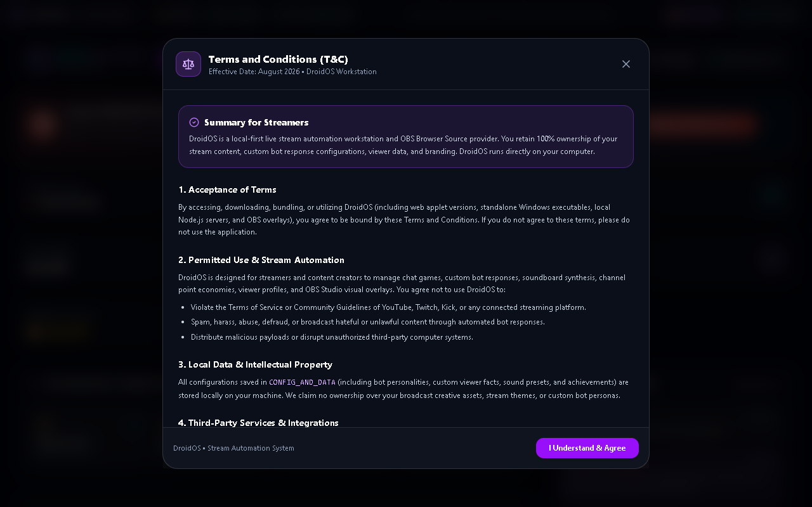

# DroidOS

**A local-first YouTube chatbot and OBS stream-control workstation for Windows creators.**

DroidOS brings chat automation, viewer rewards, custom commands, and stream actions together in one desktop app—while keeping your data on your own machine.

## Features

- **YouTube chat automation** — configurable bot behaviour, commands, and responses.
- **Viewer profiles and points** — track viewer activity and run a stream rewards economy.
- **Custom redeems and chat games** — make streams more interactive.
- **OBS integration** — trigger scenes, sources, effects, and alerts from chat.
- **Local-first data** — settings and credentials stay on your computer.

## Download and install

1. Visit the [Releases page](https://github.com/MRADDICTIVE27/DroidOS/releases).
2. Download the latest DroidOS installer.
3. Run the installer and launch DroidOS.
4. In **Settings**, connect your YouTube account; connect OBS if you want stream automation.

## Setup

DroidOS uses your own Google/YouTube credentials for live-chat access. Follow the in-app setup flow, then authorise the account that manages your channel. OBS integration is optional.

## Privacy

DroidOS is designed to run locally. Keep your Google credentials, API keys, and access tokens private—never upload them to GitHub.

## Project status

DroidOS is actively evolving. See [release notes](RELEASE_NOTES.md) for version-specific changes and known updates.
